# Diagrama físico do banco integrado

Gerado dos models SQLAlchemy. Somente FKs físicas são desenhadas; referências lógicas estão no relatório de integração.

```mermaid
erDiagram
    alerts {
        CHAR_32_ user_id
        VARCHAR_16_ type
        VARCHAR_500_ message
        DATE occurs_on
        BOOLEAN read
        CHAR_32_ id PK
        DATETIME created_at
        DATETIME updated_at
    }
    companies {
        CHAR_32_ responsible_user_id
        VARCHAR_160_ legal_name
        VARCHAR_160_ trade_name
        VARCHAR_14_ cnpj
        VARCHAR_32_ phone
        VARCHAR_254_ email
        BOOLEAN active
        CHAR_32_ id PK
        DATETIME created_at
        DATETIME updated_at
    }
    coupons {
        VARCHAR_160_ title
        VARCHAR_2000_ description
        INTEGER cost_points
        CHAR_32_ provider_id
        BOOLEAN active
        CHAR_32_ id PK
        DATETIME created_at
        DATETIME updated_at
    }
    favorites {
        CHAR_32_ user_id
        CHAR_32_ provider_id
        CHAR_32_ id PK
        DATETIME created_at
        DATETIME updated_at
    }
    manager_accounts {
        CHAR_32_ manager_user_id
        CHAR_32_ plan_id
        INTEGER balance
        CHAR_32_ id PK
        DATETIME created_at
        DATETIME updated_at
    }
    plans {
        VARCHAR_30_ code
        VARCHAR_60_ name
        INTEGER price_cents
        SMALLINT tier
        INTEGER max_dependents
        INTEGER monthly_review_limit
        SMALLINT points_multiplier
        BOOLEAN highlighted
        JSONB features
        SMALLINT sort_order
        BOOLEAN is_active
        CHAR_32_ id PK
        DATETIME created_at
        DATETIME updated_at
    }
    professionals {
        CHAR_32_ created_by
        CHAR_32_ user_id
        VARCHAR_160_ name
        VARCHAR_100_ registration
        VARCHAR_160_ specialty
        VARCHAR_2000_ photo_url
        CHAR_32_ id PK
        DATETIME created_at
        DATETIME updated_at
    }
    provider_categories {
        VARCHAR_160_ name
        BOOLEAN active
        CHAR_32_ id PK
        DATETIME created_at
        DATETIME updated_at
    }
    provider_tags {
        VARCHAR_160_ name
        BOOLEAN active
        CHAR_32_ id PK
        DATETIME created_at
        DATETIME updated_at
    }
    providers {
        CHAR_32_ owner_user_id
        VARCHAR_160_ display_name
        VARCHAR_3000_ description
        VARCHAR_2000_ photo_url
        VARCHAR_32_ phone
        VARCHAR_254_ contact_email
        VARCHAR_16_ status
        CHAR_32_ reviewed_by
        DATETIME reviewed_at
        VARCHAR_1000_ review_reason
        CHAR_32_ id PK
        DATETIME created_at
        DATETIME updated_at
    }
    reviews {
        CHAR_32_ user_id
        CHAR_32_ provider_id
        INTEGER rating
        VARCHAR_2000_ comment
        VARCHAR_2000_ provider_response
        CHAR_32_ id PK
        DATETIME created_at
        DATETIME updated_at
    }
    users {
        VARCHAR_254_ email
        VARCHAR_255_ password_hash
        VARCHAR_120_ full_name
        VARCHAR_20_ role
        BOOLEAN is_active
        CHAR_32_ id PK
        DATETIME created_at
        DATETIME updated_at
    }
    company_employees {
        CHAR_32_ company_id FK
        CHAR_32_ user_id
        VARCHAR_60_ employee_number
        VARCHAR_160_ department
        VARCHAR_16_ role
        BOOLEAN active
        CHAR_32_ id PK
        DATETIME created_at
        DATETIME updated_at
    }
    coupon_plans {
        CHAR_32_ coupon_id FK
        CHAR_32_ plan_id
        CHAR_32_ id PK
        DATETIME created_at
        DATETIME updated_at
    }
    dependents {
        CHAR_32_ account_id FK
        VARCHAR_10_ type
        VARCHAR_160_ name
        DATE birth_date
        VARCHAR_80_ bond
        VARCHAR_80_ species
        BOOLEAN can_redeem_coupons
        CHAR_32_ linked_user_id
        BOOLEAN active
        CHAR_32_ id PK
        DATETIME created_at
        DATETIME updated_at
    }
    ocr_readings {
        CHAR_32_ user_id FK
        VARCHAR_12_ status
        VARCHAR_12_ source
        FLOAT confidence
        JSONB review_fields
        JSONB extracted
        VARCHAR_64_ file_key
        VARCHAR_40_ mime_type
        INTEGER size
        DATETIME confirmed_at
        CHAR_32_ id PK
        DATETIME created_at
        DATETIME updated_at
    }
    password_reset_tokens {
        CHAR_32_ user_id FK
        VARCHAR_64_ token_hash
        DATETIME expires_at
        DATETIME used_at
        CHAR_32_ id PK
        DATETIME created_at
        DATETIME updated_at
    }
    platform_reviews {
        VARCHAR_120_ author_name
        VARCHAR_20_ reviewer_profile
        SMALLINT rating
        TEXT comment
        CHAR_32_ user_id FK
        BOOLEAN is_published
        TEXT admin_reply
        DATETIME replied_at
        CHAR_32_ replied_by FK
        CHAR_32_ id PK
        DATETIME created_at
        DATETIME updated_at
    }
    point_transactions {
        CHAR_32_ account_id FK
        VARCHAR_10_ type
        INTEGER amount
        VARCHAR_160_ origin
        CHAR_32_ redemption_id
        CHAR_32_ id PK
        DATETIME created_at
        DATETIME updated_at
    }
    provider_professionals {
        CHAR_32_ provider_id FK
        CHAR_32_ professional_id FK
        VARCHAR_20_ role
        BOOLEAN active
        CHAR_32_ id PK
        DATETIME created_at
        DATETIME updated_at
    }
    provider_tag_links {
        CHAR_32_ provider_id FK
        CHAR_32_ tag_id FK
        CHAR_32_ id PK
        DATETIME created_at
        DATETIME updated_at
    }
    referrals {
        VARCHAR_120_ professional_name
        VARCHAR_120_ specialty
        VARCHAR_160_ contact
        CHAR_32_ referrer_user_id FK
        VARCHAR_20_ status
        CHAR_32_ id PK
        DATETIME created_at
        DATETIME updated_at
    }
    refresh_tokens {
        CHAR_32_ user_id FK
        VARCHAR_64_ token_hash
        DATETIME expires_at
        DATETIME revoked_at
        CHAR_32_ id PK
        DATETIME created_at
        DATETIME updated_at
    }
    service_definitions {
        CHAR_32_ category_id FK
        VARCHAR_160_ name
        VARCHAR_2000_ description
        BOOLEAN active
        CHAR_32_ id PK
        DATETIME created_at
        DATETIME updated_at
    }
    subscriptions {
        CHAR_32_ user_id FK
        CHAR_32_ plan_id FK
        VARCHAR_20_ status
        DATETIME started_at
        DATETIME current_period_end
        DATETIME canceled_at
        DATETIME terms_accepted_at
        VARCHAR_30_ gateway_provider
        VARCHAR_100_ gateway_subscription_id
        CHAR_32_ id PK
        DATETIME created_at
        DATETIME updated_at
    }
    documents {
        CHAR_32_ user_id FK
        CHAR_32_ dependent_id FK
        VARCHAR_16_ type
        VARCHAR_200_ title
        DATE document_date
        VARCHAR_64_ file_key
        VARCHAR_40_ mime_type
        INTEGER size
        CHAR_32_ ocr_reading_id FK
        BOOLEAN shared_with_assistant
        CHAR_32_ id PK
        DATETIME created_at
        DATETIME updated_at
    }
    provider_services {
        CHAR_32_ provider_id FK
        CHAR_32_ service_id FK
        NUMERIC_12__2_ price
        NUMERIC_12__2_ min_price
        NUMERIC_12__2_ max_price
        BOOLEAN active
        CHAR_32_ id PK
        DATETIME created_at
        DATETIME updated_at
    }
    redemptions {
        CHAR_32_ coupon_id FK
        CHAR_32_ account_id FK
        CHAR_32_ redeemed_by
        CHAR_32_ beneficiary_id FK
        VARCHAR_32_ token
        VARCHAR_10_ status
        INTEGER points_debited
        CHAR_32_ idempotency_key
        DATETIME expires_at
        DATETIME used_at
        CHAR_32_ id PK
        DATETIME created_at
        DATETIME updated_at
    }
    schedule_events {
        CHAR_32_ user_id
        CHAR_32_ dependent_id FK
        VARCHAR_160_ title
        DATETIME event_at
        CHAR_32_ id PK
        DATETIME created_at
        DATETIME updated_at
    }
    service_requests {
        CHAR_32_ provider_id FK
        VARCHAR_160_ suggested_name
        VARCHAR_2000_ description
        VARCHAR_16_ status
        CHAR_32_ decided_by
        DATETIME decided_at
        VARCHAR_1000_ decision_reason
        CHAR_32_ service_id FK
        CHAR_32_ id PK
        DATETIME created_at
        DATETIME updated_at
    }
    prescriptions {
        CHAR_32_ user_id FK
        CHAR_32_ ocr_reading_id FK
        CHAR_32_ document_id FK
        VARCHAR_160_ doctor
        DATE prescription_date
        CHAR_32_ id PK
        DATETIME created_at
        DATETIME updated_at
    }
    vaccines {
        CHAR_32_ user_id FK
        CHAR_32_ dependent_id FK
        VARCHAR_160_ name
        VARCHAR_80_ dose
        DATE applied_on
        DATE next_dose_on
        CHAR_32_ document_id FK
        BOOLEAN shared_with_assistant
        CHAR_32_ id PK
        DATETIME created_at
        DATETIME updated_at
    }
    medications {
        CHAR_32_ user_id FK
        CHAR_32_ dependent_id FK
        CHAR_32_ prescription_id FK
        VARCHAR_12_ source
        VARCHAR_160_ name
        VARCHAR_80_ dose
        VARCHAR_160_ posology
        DATE start_date
        INTEGER duration_days
        VARCHAR_5_ first_dose
        DATE ended_on
        CHAR_32_ id PK
        DATETIME created_at
        DATETIME updated_at
    }
    dose_intakes {
        CHAR_32_ medication_id FK
        DATE date
        VARCHAR_5_ time
        CHAR_32_ id PK
        DATETIME created_at
        DATETIME updated_at
    }
    companies ||--o{ company_employees : "company_id"
    coupons ||--o{ coupon_plans : "coupon_id"
    manager_accounts ||--o{ dependents : "account_id"
    users ||--o{ ocr_readings : "user_id"
    users ||--o{ password_reset_tokens : "user_id"
    users |o--o{ platform_reviews : "user_id"
    users |o--o{ platform_reviews : "replied_by"
    manager_accounts ||--o{ point_transactions : "account_id"
    providers ||--o{ provider_professionals : "provider_id"
    professionals ||--o{ provider_professionals : "professional_id"
    providers ||--o{ provider_tag_links : "provider_id"
    provider_tags ||--o{ provider_tag_links : "tag_id"
    users |o--o{ referrals : "referrer_user_id"
    users ||--o{ refresh_tokens : "user_id"
    provider_categories ||--o{ service_definitions : "category_id"
    users ||--o{ subscriptions : "user_id"
    plans ||--o{ subscriptions : "plan_id"
    users ||--o{ documents : "user_id"
    dependents |o--o{ documents : "dependent_id"
    ocr_readings |o--o{ documents : "ocr_reading_id"
    providers ||--o{ provider_services : "provider_id"
    service_definitions ||--o{ provider_services : "service_id"
    coupons ||--o{ redemptions : "coupon_id"
    manager_accounts ||--o{ redemptions : "account_id"
    dependents |o--o{ redemptions : "beneficiary_id"
    dependents |o--o{ schedule_events : "dependent_id"
    providers ||--o{ service_requests : "provider_id"
    service_definitions |o--o{ service_requests : "service_id"
    users ||--o{ prescriptions : "user_id"
    ocr_readings ||--o{ prescriptions : "ocr_reading_id"
    documents |o--o{ prescriptions : "document_id"
    users ||--o{ vaccines : "user_id"
    dependents |o--o{ vaccines : "dependent_id"
    documents |o--o{ vaccines : "document_id"
    users ||--o{ medications : "user_id"
    dependents |o--o{ medications : "dependent_id"
    prescriptions |o--o{ medications : "prescription_id"
    medications ||--o{ dose_intakes : "medication_id"
```

Total: 34 tabelas de aplicação (alembic_version é controle de versão).
